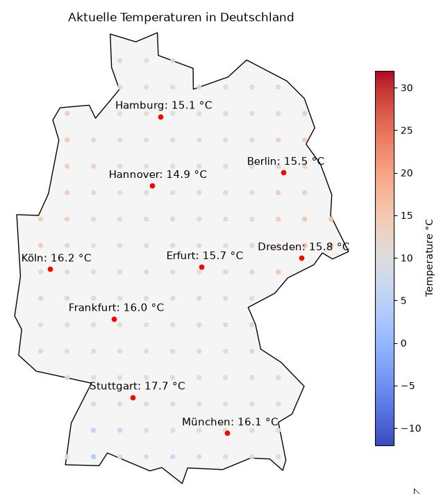

# Projekt: Wetterkarte Deutschland

### Über Open-Meteo.com werden Wetterdaten abgefragt, gespeichert und angezeigt. Die Temperaturwerte werden erstens für mehrere große Städte und zweitens für alle Punkte eines frei konfigurierbaren Gitters heruntergeladen. Für die Städte werden jeweils Name und Termperatur angezeigt. Die Werte des Gitters werden zur räumlichen Inter- und zeitlichen Extrapolation genutzt. So wird [zukünftig (Stand 25.10.26)] eine, per Farbskala kenntliche gemachte, Flächendarstellung erstellt und eine, per ML generierte, Vorhersage gebildet.

<br>

## Anforderungen: 
- Python 3.13.15
- Python Packages in requirements.txt
- Wetterdaten von Open-Meteo

## Installation:

### Virtuelle Umgebung erstellen:

```python 
python -m venv .venv
```
### Benötigte Packages installieren:
```python 
.\.venv\Scripts\python.exe -m pip install -r requirements.txt
```
## Nutzung:

### Führen Sie das Programm über main.py im Projektordner aus.

### Es stehen mehrere Parameter zur Verfügung, mit denen z.B. die Eigenschaften des Gitters konfiguriert werden können:
- "buffer" in create_grid() erweitert die Landesgrenze um den angegeben Wert in m. Dadurch wird der Bereich definiert, in dem das Gitter erstellt wird.
- "spacing" in create_grid() bestimmt den Abstand zwischen 2 benachbarten Gitterpunkten in m.
- "vmin" und "vmax" in print_grid_temperatures() regeln den Minimal- und Maximalwert der genutzten Farbskala. Werte außerhalb des Bereichs werden in der Farbe des entsprechenden Grenzwerts angezeigt.

### Es gibt noch weitere Parameter, die im Code genutzt werden. Diese sollen im weiteren Verlauf noch sauberer verarbeitet und kohährenter eingebunden werden. Sie zu ändern, führt aktuell vermutlich schnell dazu, daß das Programm nicht startet.

## Mögliche zukünftige Erweiterungen sind: 
- Vorhersage basierend auf vorliegenden Daten (bereits in Planung)
- farbbasierte Flächendarstellung, interpoliert durch Gitterwerte (bereits in Planung)
- die Darstellung von weiteren Wetterdaten wie Wind und Niederschlag
- gezielte Anfragen für kleinere Gebiete, die ein engeres Gitter nutzen
- Einbezug weiterer Länder

## Beispiel mit angezeigten Gitterpunkten vom 25.10.26:

